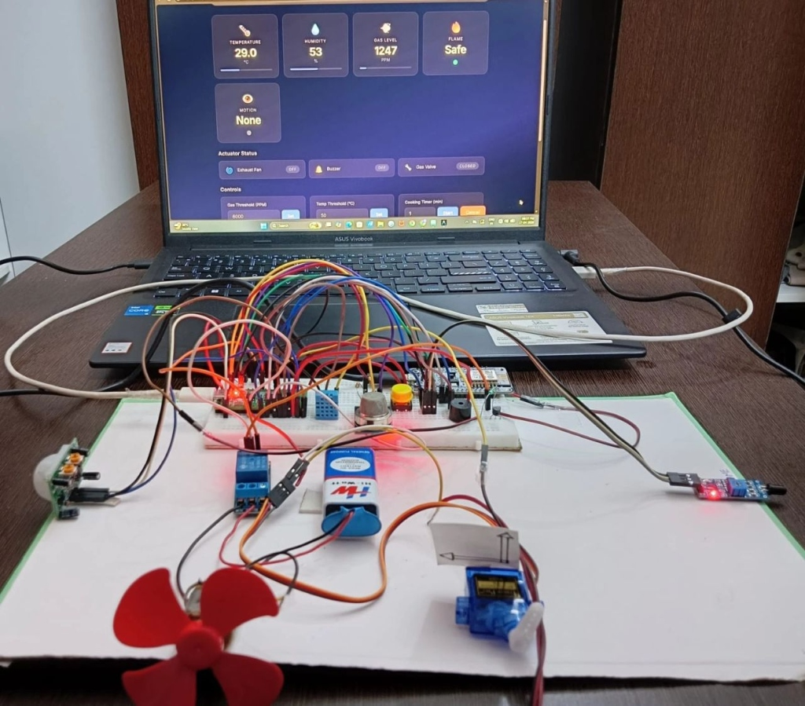
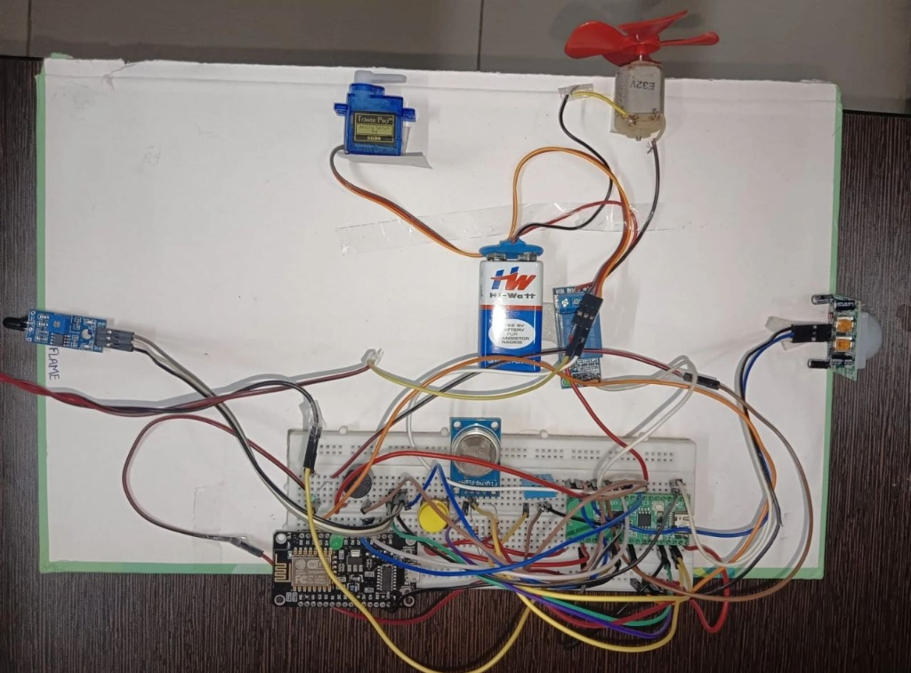
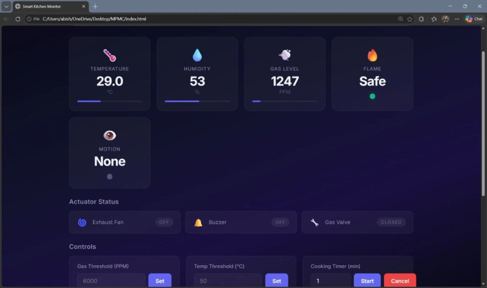
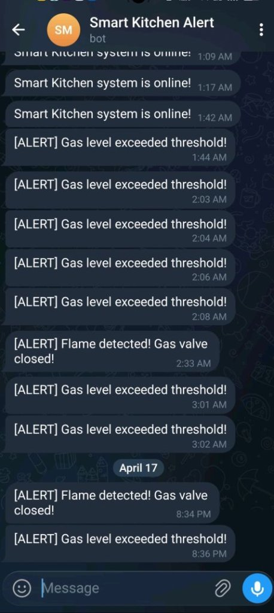
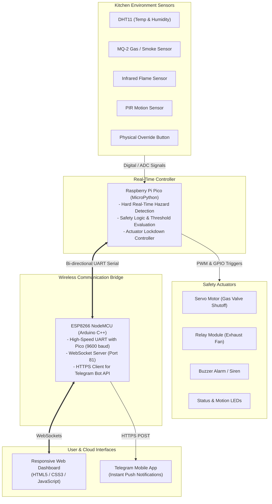

# Context-Aware Smart Kitchen Safety System with IoT Dashboard & Telegram-Based Alerting 🍳🔒

An intelligent, context-aware dual-microcontroller smart kitchen safety and real-time monitoring system. This project integrates a **Raspberry Pi Pico** (handling hard real-time safety logic, sensor polling, thermal shutdown, and automated valve control) and an **ESP8266 NodeMCU** (Wi-Fi WebSocket bridge & Telegram bot notifications) serving a responsive **Dark-Mode IoT Web Dashboard**.

---

## 📸 Project Demonstration & Media

### 🎥 Working Demo Video
Watch the full project walkthrough and hardware demonstration in action:

▶️ **[Watch Project Demo Video on Google Drive](https://drive.google.com/file/d/1Uai0teUW1F0Ts2fL-v9hLNXnDiluZxP6/view?usp=sharing)**  
*(Folder archive: [Google Drive Project Media](https://drive.google.com/drive/folders/1ytq5GDOAmccYYJ0MjeMIaaZal2vd0l3z?usp=drive_link))*

---

### 📷 Hardware Setup & Working Prototype

| System Prototype in Action | Hardware Top View & Sensor Placement |
| :---: | :---: |
|  |  |
| *Raspberry Pi Pico + ESP8266 connected with sensors and live Web Dashboard* | *Top-down layout of DHT11, MQ-2, Flame Sensor, PIR, Servo, Fan Relay, and Buzzer* |

---

### 💻 IoT Web Dashboard & Telegram Alerts

| Real-Time IoT Web Dashboard | Instant Telegram Safety Bot Notifications |
| :---: | :---: |
|  |  |
| *Live telemetry: Temperature, Humidity, Gas (PPM), Flame status, Motion, and manual control overrides* | *Instant real-time mobile push notifications for gas leaks, flame triggers, and unattended stove warnings* |

---

## ✨ Key Features

* **Context-Aware Safety Interventions:** Distinguishes between normal cooking activity and hazard conditions (e.g. unattended stove, persistent gas leaks, or fire breakouts).
* **Live Telemetry Dashboard:** WebSocket-based real-time telemetry streaming:
  * Ambient Temperature (°C) & Relative Humidity (%) via DHT11
  * LPG / Smoke / Gas Concentration (PPM) via MQ-2
  * Flame Detection (Safe / Active Fire alert)
  * Kitchen Occupancy & Motion tracking via PIR sensor
* **Automated Physical Valve Lockdown:** Servo motor automatically rotates to physically cut off the gas supply line when a hazard threshold is breached.
* **Instant Emergency Actuation:** Automated exhaust fan relay activation and piezo siren alerts during critical states.
* **Telegram Bot Push Alerts:** Emergency notifications dispatched directly to user smartphones via Telegram Bot API with low latency.
* **Intelligent Auto-Release Overrides:** Manual control over the fan, buzzer, and servo via the dashboard, with auto-release reverting to automated safety mode once hazards clear.
* **Hardware Panic Override:** Physical push-button mechanism on the breadboard to silence alerts and reset the system locally.

---

## 🏗️ System Architecture



---

## 🔌 Hardware Wiring & Pin Mapping

### 1. Raspberry Pi Pico (Primary Controller)

| Component | Pico Pin | Type / Function |
| :--- | :--- | :--- |
| **DHT11 Temp & Humidity Sensor** | `GP15` | Digital Input (1-Wire Data) |
| **MQ-2 Gas Sensor (Analog)** | `GP26` (ADC0) | 12-bit ADC Input |
| **Flame Detection Sensor** | `GP14` | Digital Input (Active Low / Interrupt) |
| **PIR Motion Sensor** | `GP13` | Digital Input |
| **Hardware Panic Push Button** | `GP16` | Digital Input (Internal Pull-Up) |
| **Piezo Buzzer / Alarm** | `GP12` | Digital Output |
| **Exhaust Fan Relay** | `GP11` | Digital Output |
| **Servo Motor (Gas Valve)** | `GP10` | PWM Output (50 Hz) |
| **Hazard Alert LED (Red)** | `GP17` | Digital Output |
| **Occupancy LED (Green)** | `GP18` | Digital Output |
| **UART TX (to ESP8266 RX)** | `GP8` | Hardware UART0 TX |
| **UART RX (from ESP8266 TX)**| `GP9` | Hardware UART0 RX |

> **⚠️ Common Ground Requirement:** Always bridge a `GND` pin from the Raspberry Pi Pico to a `GND` pin on the ESP8266 to maintain a unified logic reference.

---

### 2. ESP8266 NodeMCU (Wi-Fi & Cloud Gateway)

| Component / Function | ESP8266 Pin | Notes |
| :--- | :--- | :--- |
| **UART RX** | `RX` | Connects to Pico `GP8` (Pico TX) |
| **UART TX** | `TX` | Connects to Pico `GP9` (Pico RX) |
| **Common GND** | `GND` | Shared with Raspberry Pi Pico GND |
| **Power Supply** | `Vin / 5V` & `GND` | 5V external rail or USB power |

---

## 📂 Repository Structure

```
├── assets/
│   └── images/
│       ├── system_setup.jpg        # Complete hardware prototype + live dashboard
│       ├── hardware_top_view.jpg   # Top-view breadboard & sensor wiring layout
│       ├── iot_dashboard.jpg       # Dark-mode telemetry Web UI screenshot
│       └── telegram_alerts.jpg     # Telegram bot alert message feed
├── main.py                         # MicroPython runtime & safety control loop for Pi Pico
├── esp8266_bridge.ino              # Arduino C++ sketch for ESP8266 (WebSocket + Telegram)
├── index.html                      # Real-time IoT monitoring dashboard UI
├── app.js                          # WebSocket client & dynamic dashboard state management
├── styles.css                      # Modern glassmorphism dark-mode UI styling
└── README.md                       # Complete documentation & wiring guide
```

---

## 🚀 Quickstart Guide

### 1. Flash the Raspberry Pi Pico
1. Flash the latest **MicroPython** firmware onto your Raspberry Pi Pico.
2. Open **Thonny IDE** and set the interpreter to *MicroPython (Raspberry Pi Pico)*.
3. Save [`main.py`](main.py) to the root of the Pico.
4. The Pico will initialize GPIO pins, calibrate the gas sensor baseline, and begin polling telemetry.

### 2. Configure & Flash the ESP8266
1. Install the ESP8266 board definitions in the **Arduino IDE**.
2. Install required libraries:
   * `WebSockets` by Markus Sattler
   * `ESP8266WiFi` & `ESP8266HTTPClient` (bundled with ESP8266 core)
3. Open [`esp8266_bridge.ino`](esp8266_bridge.ino) and update your Wi-Fi credentials and Telegram Bot configurations:
   ```cpp
   const char* WIFI_SSID = "YOUR_WIFI_SSID";
   const char* WIFI_PASS = "YOUR_WIFI_PASSWORD";

   const char* BOT_TOKEN = "YOUR_TELEGRAM_BOT_TOKEN";
   const char* CHAT_ID   = "YOUR_TELEGRAM_CHAT_ID";
   ```
4. Flash the code to the ESP8266 (*disconnect TX/RX wires temporarily during upload if sharing the serial port*).
5. Open the Serial Monitor at **9600 baud** to note the assigned local IP address (e.g. `192.168.1.100`).

### 3. Launch the Web Dashboard
1. Open [`index.html`](index.html) in any modern browser.
2. Enter the ESP8266's IP address in the connection bar at the top right.
3. Click **Connect**. The indicator dot will turn green, streaming live kitchen metrics and safety states.

---

## 📱 Telegram Alert Triggers

The system automatically dispatches the following alerts via the Telegram Bot:
* `[ALERT] Gas level exceeded threshold!` — Triggered when MQ-2 gas concentration crosses preset safety limit.
* `[ALERT] Flame detected! Gas valve closed!` — Immediate critical alert upon optical IR flame trigger.
* `[ALERT] Stove unattended for 10 min - system shut down!` — Context-aware timer alert if no movement is observed near an active heat/flame zone.

---

## 🛠️ Built With

* **Hardware & Firmware:**
  * [MicroPython](https://micropython.org/) — Real-time sensor sampling & actuator logic on Raspberry Pi Pico
  * [Arduino C++](https://www.arduino.cc/) — ESP8266 Wi-Fi networking, WebSocket server, and HTTPS client
* **Frontend Web Application:**
  * Modern HTML5, CSS3 (Glassmorphism design, CSS Grid/Flexbox)
  * JavaScript (ES6+ WebSockets & dynamic DOM updates)
  * [Lucide Icons](https://lucide.dev/) — Vector UI iconography
* **Cloud & Communication:**
  * [Telegram Bot API](https://core.telegram.org/bots/api) — Secure, real-time mobile push alerting
  * WebSocket Protocol (RFC 6455) — Low-latency bidirectional browser-to-hardware communication

